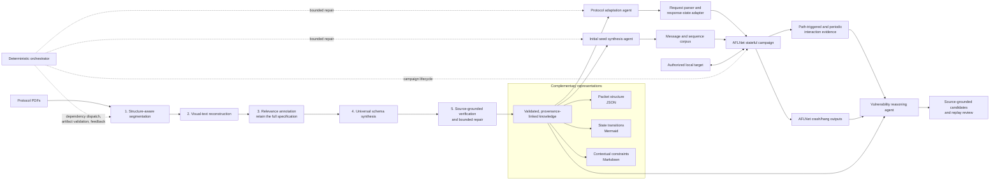

# AFL-ICP+

**From industrial protocol specifications to state-aware fuzzing and specification-conformance analysis**

## 1. Introduction

Industrial control protocol specifications are difficult to use directly in fuzz testing: normative rules are scattered across long documents, tables, diagrams, message formats, state transitions, and prose constraints. Binary industrial protocols also lack a common response-status field that a stateful fuzzer can use uniformly. Finally, coverage and crash detection alone cannot identify every implementation that violates protocol semantics without crashing.

AFL-ICP+ addresses these gaps by making protocol knowledge a shared, source-grounded artifact across the fuzzing lifecycle. Built on AFLNet, it connects specification formalization, protocol adaptation, initial-seed synthesis, stateful fuzzing, and post-campaign reasoning. The implementation uses a deterministic dependency-aware orchestration DAG to run specialist tasks, validate their artifacts, route diagnostics, and stop before fuzzing if required preparation fails. LLMs assist with semantic reconstruction and code/input synthesis; they are not called in the fuzzing hot path.



*The diagram summarizes the method architecture; implementation scope and gaps are listed below.*

### Core Features

* **Source-grounded multimodal specification formalization.** A five-stage pipeline performs hierarchy-aware segmentation, visual/textual reconstruction, relevance annotation, universal-schema synthesis, and adversarial consistency verification. It annotates the complete specification instead of discarding sections judged irrelevant, preserving evidence for later fallback and review.
* **A complementary universal protocol schema.** Static packet layouts, temporal state transitions, and contextual semantic dependencies are represented separately as JSON, Mermaid, and structured Markdown. The bundle keeps `client/requests.json`, `server/responses.json`, client/server `state_machine.mmd`, and client/server `contextual_dependencies.md` as separate artifacts. Source metadata links extracted facts back to their originating documents and pages. Together these views support input construction and post-run behavior checking.
* **Protocol adaptation for binary stateful fuzzing.** The adaptation agent synthesizes request-boundary parsing and response-state extraction against the fuzzer's adapter interface. To address the absence of a universal status code in industrial protocols, it derives stable abstract states from protocol-defined response fields, including composite field tuples when state identity depends on more than one field. Review, compilation, integration checks, and diagnostics form a bounded repair loop.
* **Constraint-guided seed synthesis at two levels.** A reusable generator program is synthesized from the protocol schema and annotated specification. It creates both individual messages and multi-message sequences, varying message types, field configurations, and protocol paths rather than relying on repeated free-form prompts alone.
* **Record-then-check specification-conformance reasoning.** New-coverage interactions and periodic samples are recorded during fuzzing; LLM-based reasoning is deferred until after the campaign. The reviewer compares observed requests, responses, and state transitions with the specification and requires source evidence. Conventional crash/hang detection and specification-based semantic reasoning provide complementary signals.
* **Dependency-aware orchestration and reproducible artifacts.** Preparation stages run only when their inputs are available. Validation failures and runtime diagnostics are routed back to the responsible stage within user-configured retry budgets; an invalid required artifact prevents campaign launch. Run manifests, hashes, model usage, and evidence support later inspection and reproduction.

### Supported Protocols

The first supported end-to-end workflow is **Modbus/TCP** (`MODBUS`) using the included libmodbus target recipe. The runtime adapter registry also contains legacy entries for `MQTT`, `IEC104`, `ETHERNETIP`, `BACNETIP`, `DNP3`, `OPCUACP`, `SLMPA`, and `SLMPB`. Registry presence alone does not imply that a protocol's complete preparation, target recipe, or Linux end-to-end workflow has been validated.

The target manager currently supports the known libmodbus recipe and an explicitly configured local executable. An arbitrary GitHub URL is not sufficient to infer how an unknown target should be built; other targets need a reviewed recipe or a prebuilt executable and launch configuration.

## 2. Installation

The recommended deployment is an isolated x86-64 Ubuntu Linux host. The Linux engine build, Docker sandbox, target build, and complete campaign have not yet been validated in this macOS development workspace; treat the current tree as a research prototype until the Linux acceptance steps pass.

### Prerequisites

```bash
sudo apt-get update
sudo apt-get install -y \
  build-essential clang llvm llvm-dev make \
  graphviz libgraphviz-dev libcap-dev \
  autoconf automake libtool pkg-config \
  git python3 python3-venv tesseract-ocr
```

Docker Engine is required for the constrained seed-generator sandbox and target build. Install it using the official instructions for the server distribution: [Ubuntu](https://docs.docker.com/engine/install/ubuntu/) or [Debian](https://docs.docker.com/engine/install/debian/). The account running AFL-ICP+ must be allowed to access the Docker daemon.

### Install AFL-ICP+

```bash
git clone git@github.com:YOUR_GITHUB_USERNAME/AFL-ICP-plus.git
cd AFL-ICP-plus

# Keep the Python virtual environment outside the engine source tree.
python3 -m venv ../.venv-aflicp
source ../.venv-aflicp/bin/activate
python -m pip install --upgrade pip
python -m pip install -e ./harness
```

Optional layout/table OCR support:

```bash
python -m pip install -e './harness[layout]'
```

PP-StructureV3 also requires suitable local model files, particularly when running offline. The default PDF path uses PyMuPDF text extraction and falls back to Tesseract for OCR; the multimodal reconstruction step uses the configured vision model. Mistral OCR is not required by this implementation.

## 3. Usage

### Configure input and providers

Place the protocol PDF files and the original user-supplied C0 corpus in local directories outside the source checkout. Then create the machine-specific configuration:

```bash
cp harness/config.example.yaml harness/config.yaml
nano harness/config.yaml
```

Configure at least:

1. `specifications`: one or more PDF paths, each with a unique document ID.
2. `paths.user_seeds`: the original C0 directory; `paths.engine_root` should point to the repository root; `paths.output_root` should be a separate run-output directory.
3. `protocol: MODBUS` for the initial end-to-end workflow.
4. The `text`, `vision`, `coding`, and `reasoning` profiles, including provider, endpoint, model, and API-key environment variable name.
5. `target`: the supported `libmodbus` recipe with an immutable source revision and local build image ID, or an explicitly reviewed local executable. Keep the configured endpoint on loopback/private lab networking.
6. `campaign`, `evidence`, `analysis`, and `experiment` parameters, including run duration, retry budgets, periodic sampling interval, replay count, and repetitions.

Do not store API key values in YAML or commit `harness/config.yaml`. If all four profiles use the same key, set each profile's `api_key_env` to `AFLICP_API_KEY` and export it in the current shell:

```bash
read -r -s -p 'LLM API key: ' AFLICP_API_KEY
printf '\n'
export AFLICP_API_KEY
```

### Build local Docker images

Build the seed-generator sandbox and the libmodbus target-build image, then copy their image IDs into `seeds.sandbox.image` and `target.build_image` in `harness/config.yaml`:

```bash
cd harness

docker build -f Dockerfile.generator -t aflicp-generator:local .
docker image inspect --format '{{.Id}}' aflicp-generator:local

docker build -f Dockerfile.target-build -t aflicp-target-build:local .
docker image inspect --format '{{.Id}}' aflicp-target-build:local

cd ..
```

### Prepare and start a campaign

Configuration validation is local-only. `prepare` runs the deterministic preparation DAG; it may call the configured LLM, fetch the pinned target source, build artifacts, and perform a representative dry-run against the configured local target. It does not start the full fuzz campaign, but the dry-run does send protocol data to that target.

```bash
source ../.venv-aflicp/bin/activate
aflicp validate-config --config harness/config.yaml
aflicp prepare --config harness/config.yaml
```

Save the `run_id` printed by `prepare`, check the preparation status, and explicitly start fuzzing only after confirming the target and launch barrier:

```bash
RUN_ID='REPLACE_WITH_RUN_ID'
aflicp status --config harness/config.yaml --run-id "$RUN_ID"
aflicp run --config harness/config.yaml --run-id "$RUN_ID"
```

The fuzzer uses the generated corpus prepared for the run. No LLM call is made on the fuzzing hot path. Use `aflicp resume` only for an incomplete campaign. `aflicp experiment` starts the configured real repetitions; it is not a planning-only command.

### Analyze and export

After the campaign completes:

```bash
aflicp analyze --config harness/config.yaml --run-id "$RUN_ID"
aflicp export --config harness/config.yaml --run-id "$RUN_ID" \
  --output "$HOME/aflicp-output/$RUN_ID.tar.gz"
```

The analysis replays selected recorded interactions against the configured local target and applies source/reviewer/replay gates to candidate findings. A model finding is still a research result that requires human assessment.

The detailed Chinese command-by-command guide is [harness/使用说明.md](harness/使用说明.md). Component and artifact details are in [harness/README.md](harness/README.md).

## 4. Tutorial — Modbus/TCP with the libmodbus test target

This tutorial uses only an authorized local simulator. Do not replace the loopback target with production equipment or an unapproved network service.

### Step 1. Prepare the lab inputs

Create local folders for the PDF and the original C0 seeds, and place at least one non-empty seed in C0:

```bash
mkdir -p "$HOME/aflicp-data/specs" "$HOME/aflicp-data/seeds/C0"
# Copy your Modbus specification PDF into specs/ and your original seeds into seeds/C0/.
```

### Step 2. Configure the Modbus run

Copy and edit the example config as described above. Set `protocol` to `MODBUS`, point `specifications` to the local PDF, point `paths.user_seeds` to `$HOME/aflicp-data/seeds/C0`, and place run outputs outside the checkout. Configure a pinned libmodbus source revision, the local Docker image IDs, and an unused loopback port such as `127.0.0.1:1502`. Set LLM credentials through the configured environment variable names.

### Step 3. Validate and prepare

```bash
source ../.venv-aflicp/bin/activate
aflicp validate-config --config harness/config.yaml
aflicp prepare --config harness/config.yaml
```

`prepare` renders the specification pages, reconstructs and annotates protocol knowledge, synthesizes and validates the client/server schema bundle, generates and builds the adapter, generates and filters seeds, prepares the local target, and checks the C0 interactions against the launch barrier. Inspect `aflicp status` and the run's `diagnostics.jsonl` if a stage fails; do not bypass failed validation by editing generated status artifacts.

### Step 4. Run the campaign

```bash
RUN_ID='REPLACE_WITH_RUN_ID'
aflicp status --config harness/config.yaml --run-id "$RUN_ID"
aflicp run --config harness/config.yaml --run-id "$RUN_ID"
```

The target and campaign are launched as local processes by the harness/AFLNet on the Linux host. Docker is used for seed generation and target building, not as runtime isolation for the campaign. Use a disposable lab VM or equivalent isolation for binaries that are not fully trusted.

### Step 5. Review results

```bash
aflicp analyze --config harness/config.yaml --run-id "$RUN_ID"
```

Important artifacts are stored under the configured run directory:

- `knowledge/`: client/server packet schemas, state machines, contextual dependencies, and source metadata;
- `corpus/input/`: flat generated seed corpus used by AFLNet;
- `fuzz/<campaign-id>/`: AFLNet queue, crash/hang outputs, and campaign logs;
- `interactions/campaigns/<campaign-id>/`: recorded interaction evidence;
- `analysis/revisions/` and `analysis/report.json`: reviewed finding candidates and summary;
- `usage/usage.jsonl`: available LLM usage and cost records.

## 5. Method-to-implementation status

The README describes the research method while distinguishing implementation limits that matter for experiments:

| Method component | Current implementation status |
|---|---|
| Five-stage specification formalization | Implemented as a local-first PDF text/OCR and configured vision workflow with source-linked knowledge validation. It does not require Mistral OCR. |
| Complementary universal schema | Client/server JSON packet schemas, Mermaid state machines, and structured Markdown dependencies are validated as a bundle with source references. |
| Feedback-driven protocol adaptation | Adapter synthesis and engine compilation are implemented; Modbus is the primary new end-to-end path, while other registry entries are inherited adapters and need protocol-specific validation. |
| Programmatic seed synthesis | A generated Python seed program runs in a constrained no-network Docker sandbox and produces message/sequence candidates. Current cleanup removes empty/failed files and byte-identical duplicates; it does not run `afl-tmin`/`afl-cmin` or claim behavior-preserving minimization. |
| Record-then-check conformance analysis | New-coverage and periodic evidence recording, replay, source-grounded model review, and finding gates are implemented. AFLNet retains crash/hang artifacts; complete sanitizer-based crash attribution and analysis of every crash/hang are not implemented. |
| Linux end-to-end validation | Not yet completed in this development workspace. Engine/LLVM builds, Docker execution, the local target dry-run, a full campaign, and replay must be acceptance-tested on the authorized Linux lab host. |

## 6. Isolation and attribution

Use AFL-ICP+ only against targets you own or are explicitly authorized to test. The harness accepts loopback/private IPv4 targets and does not scan for services. The fuzz campaign and replay communicate with the configured local target; they are not contained by the Docker build or seed-generation containers. Keep production networks and devices outside the test path.

AFL-ICP+ extends [AFLNet](https://github.com/aflnet/aflnet). See [LICENSE](LICENSE) for licensing terms applicable to this repository and its components.
